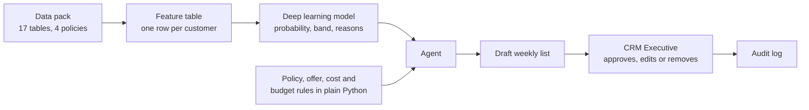

# ShopSphere Win-Back Decision Agent

IT2226 AI Innovation and Deep Learning Project, Nanyang Polytechnic, 2026 S2.

ShopSphere's CRM team spends a day and a half every Monday building a win-back list by hand. They
pick customers by days since last order and send most of them the same 10% voucher. The list is
stale by the time it is ready, vouchers go to people who would have bought anyway, and policy
breaches go unnoticed.

This project builds a tool that produces that list in minutes. For each country, each week, it
says who to contact, with which offer, through which channel and why. The list stays inside the
country's weekly budget, follows every company policy, and goes nowhere until a CRM Executive
approves it.

> **How might we make sure each week's retention budget reaches the customers it can actually
> influence, with an offer that policy allows, before anything is sent?**

## What we are building

| Part | What it does | Wish-list items |
|---|---|---|
| **A. Prediction model** | A supervised deep learning model that gives each customer a probability of buying in the next 30 days, with the reasons | W1, W2 |
| **B. AI agent** | Uses the model and the company rules to build the weekly list, explain each decision and answer staff questions | W3, W4, W9 |
| **C. App and dashboard** | Staff review and approve the list, and see trends in sales, traffic, campaigns, deliveries and customer activity | W6 |
| Stretch | Customer summary for service agents, plain-language Q&A, draft messages | W5, W7, W8 |



The model only predicts. It never decides who gets a voucher. The language model in the agent
orchestrates and explains; it never makes policy decisions. Policy checks, offer eligibility,
costs and budget fitting are deterministic Python functions the agent calls and cannot override.

## Rules we never break

- The main model is deep learning, compared fairly against at least one non-deep-learning baseline.
- Nothing is ever sent. There is no connection to real email, SMS, WhatsApp or payment systems.
- A human approves every list, and every decision has a recorded reason.
- The data pack is never altered. Anything we generate is labelled as synthetic.
- Model features use only data dated on or before **30 September 2024**.
- Open-source libraries and lecturer-approved APIs only. No API keys in the repo.

## Milestones

The guidebook and the brief give different dates. We plan to the earlier one and treat the later
one as buffer, until Mr Wee confirms.

| Week | Milestone | Weight | What must be ready |
|---|---|---|---|
| 5 (w/c 16 Nov 2026) | **Progress Review 1**: supervised model | 20% | EDA and data preparation, custom-trained model with tuning, evaluation against a baseline, notebook, live walkthrough and task |
| 7 | Mock interview | 10% | Date to confirm |
| 8 | Model checkpoint (brief) | | Short report and notebook, first test-set submission, chosen model with justification |
| 13 | Prototype demo (brief) | | Rehearsal for Progress Review 2 |
| 14 (w/c 18 Jan 2027) | **Progress Review 2**: agent and app | 30% | End-to-end app, model deployed remotely, dashboard, early evaluation |
| 18/19 (w/c 15 Feb 2027) | **Final** | 40% | Report, 20-minute demo, reproducible repo, AI Use Log, Ethical AI Checklist, reflection, peer review |

Individual work is 75% of the marks. About 30% can only be earned live, with notes and AI
assistants closed: a code walkthrough, a tutor-set change, a seeded-fault debug and questions on
your AI Use Log. Don't commit code you can't explain.

## Getting started

You need [uv](https://docs.astral.sh/uv/getting-started/installation/) and Git. uv installs the
right Python version for you.

```bash
git clone https://github.com/rider-26/AI-Innovation-with-Deep-Learning.git
cd AI-Innovation-with-Deep-Learning
uv sync                         # creates .venv and installs the modelling libraries
uv run python -m pytest         # should pass
uv run python -m jupyterlab     # open the notebooks
```

Run tools as `python -m <tool>`. Some of our laptops block the bare `pytest` and `jupyter`
launchers with a Windows Application Control error.

Then:

1. Put the ShopSphere data pack in `data/raw/`, exactly as issued. See
   [data/raw/README.md](data/raw/README.md).
2. Create your AI Use Log from [docs/ai-use-log/TEMPLATE.md](docs/ai-use-log/TEMPLATE.md).
3. Create your own branch and make your first commit from your own GitHub account.

The agent and app libraries (LangGraph, FastAPI, Streamlit) are only needed from Progress Review 2.
Install them with `uv sync --extra app`. When the LLM API is approved, copy `.env.example` to
`.env` and add the key there.

On Windows, `uv sync` installs the CPU build of PyTorch. That is enough for a small network on
64,000 rows. For a GPU, use Google Colab or Kaggle Notebooks.

## Repository layout

```
data/
  raw/          the data pack: read-only, git-ignored
  interim/      cleaned tables
  processed/    features.csv and split assignments
  synthetic/    anything we generate, labelled as synthetic
notebooks/      audit, EDA, baselines, one deep learning notebook per member
src/shopsphere/ shared Python package
  config.py       seed, cutoff date, paths, split fractions, feature column names
  split.py        the one train / validation / test split everyone uses
  data.py         loads features.csv, checks the data contract, attaches labels
  preprocess.py   imputation, scaling and one-hot encoding (fitted on train only)
  baselines.py    always-0, recency rule, logistic regression, LightGBM
  model.py        the MLP and its hyperparameters
  train.py        training loop: class weighting, early stopping
  tuning.py       random search with a run log
  metrics.py      PR-AUC, ROC-AUC, precision, recall, F1, top-10% lift, by group
  placeholder.py  synthetic stand-in data, for running the code before the real data is ready
tests/          unit tests (pytest)
models/         saved model artefacts, git-ignored
reports/        figures and write-ups
app/            Streamlit app and dashboard (from Progress Review 2)
docs/
  ai-use-log/   one log per member
  meeting-log.md
  task-board.md
```

The package grows as we build: `features/`, `models/`, `policy/`, `agent/` and `api/` are added
when there is code to put in them.

## Team agreements

**One split, one seed.** Everyone gets their split from `shopsphere.split.assign_split`, which
divides `train.csv` 70/15/15 into train, validation and test, stratified on the target, with
`SEED = 42`. Results from different splits can't be compared.

```python
import pandas as pd
from shopsphere.config import DATA_RAW
from shopsphere.split import assign_split

labels = assign_split(pd.read_csv(DATA_RAW / "train.csv"))
train = labels[labels["split"] == "train"]
```

**No leakage.** Fit imputers and scalers on the train split only. Tune, stop early, calibrate and
set thresholds on validation. Use the test split once, at the end, for the reported numbers.
`test.csv` has no labels, so never tune against it.

**Accuracy is not the metric.** Only 14.6% of customers buy, so predicting "no" for everyone
scores 85.4% accuracy. The main metric is PR-AUC (0.146 at random), reported with ROC-AUC,
precision, recall, F1 and precision in the top 10%.

**Commits.** Commit small and often, from your own account, on your own branch. Commit bulk
AI-generated code separately from your own edits, so the difference is visible in the history.

**AI Use Log.** Update it as you work. The "Why" column is what is marked: a specific check, a
specific finding, a specific action. The log must agree with your commit history. See
[docs/ai-use-log/README.md](docs/ai-use-log/README.md).

## Team

| Member | GitHub | Role | Model variant | Agent tool |
|---|---|---|---|---|
| Davian | dav_1ann | | | |
| | | | | |
| | | | | |
| | | | | |

Supervisor: Mr Wee Chee Hong.

## Documents

- [Project plan](IT2226_ShopSphere_Project_Plan.pdf): the full Design Thinking plan,
  model and agent design, test criteria, and the policy rules quick reference (Appendix B)
- [Project brief](<IT2226_ShopSphere_Brief_Student (1).docx>): the client, the wish list,
  the requirements and the data dictionary
- [Project guidebook](<IT2226_Project_Guidebook_v1.1(student) (1).pdf>): assessment, rubrics
  and the AI Use Log format
- [Resource planning guide](IT2226_Project_Resource_Planning_Guide.docx)
- [Task board](docs/task-board.md) and [meeting log](docs/meeting-log.md)
